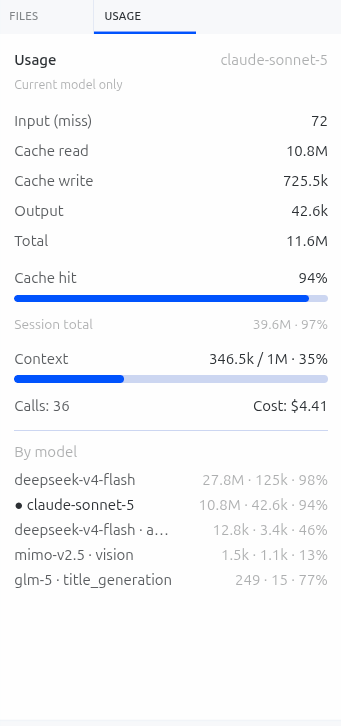

# Hermes Tally

[English](README.md) | [简体中文](README.zh.md)

A right-sidebar usage panel for the [Hermes Agent](https://github.com/NousResearch/hermes-agent) desktop app: live token consumption, **correct** cache hit rate, context fill, and estimated cost for whatever model you're actually talking to right now.

 



*Real session: a conversation that ran on `deepseek-v4-flash` and switched to `claude-sonnet-5` mid-way. The headline (94% hit rate, 11.6M tokens) describes Claude — the model actually in use — while "Session total" (39.6M · 97%) keeps the whole-session lifetime number visible underneath, and the per-model breakdown shows every model/task involved, including Hermes' own background calls (`title_generation` on `glm-5`, `vision` on `mimo-v2.5`).*

## Why this exists

Hermes' built-in status bar shows context-window fill. It does not show cache hit rate, per-model cost, or a persistent breakdown you can glance at mid-conversation — the kind of always-visible readout tools like Kilocode make obvious in their sidebar. Hermes Tally adds that pane.

Two things about it that aren't cosmetic:

- **Cache hit rate is computed correctly**: `cache_read / (cache_read + cache_write + input_miss)`. A `cache_write` (Anthropic's `cache_creation_input_tokens` — fresh content just written to the cache) is a **miss**, not a hit. Leaving it out of the denominator is an easy mistake that reads fine on DeepSeek (whose API never reports `cache_write`) and quietly inflates every Claude session toward ~100%.
- **The headline is scoped to the model you're currently on**, not a lifetime blend. A session's `sessions` table row in Hermes' `state.db` is a *whole-session* aggregate across every model you've ever switched through — if you ran 10M tokens on model A and just switched to model B, that headline is still describing model A. Tally filters `session_model_usage` down to the live model's own primary-loop calls (excluding approval/vision/title-generation side-calls) and labels the scope explicitly, with the whole-session total kept as a secondary line so nothing is hidden.

## What it shows

- Input (cache miss), cache read, cache write, output, total — for the active model, this session
- Cache hit rate, with a bar
- Context window fill (used / max, %)
- API call count and estimated cost
- Per-model / per-task breakdown (current model marked with `●`), including auxiliary calls Hermes makes on cheaper models behind the scenes (title generation, tool-call approval, vision)
- A compact statusbar chip (`92% · 4.6M`) for an at-a-glance read without opening the pane

Everything is **read-only** — it reads Hermes' own local `state.db`, never writes to it, and never touches prompt or response content.

## How it works

Two small pieces:

1. **A desktop UI plugin** (`desktop-plugins/usage-panel/`) — a right-sidebar pane + statusbar chip, plain ESM, no build step, hot-reloaded by the Hermes desktop app.
2. **A Python backend** (`plugins/usage-panel/dashboard/`) — a tiny read-only FastAPI router mounted into Hermes' own gateway process, which is the only place `cache_read`/`cache_write`/per-model cost live (Hermes' live RPCs don't expose them — see [Architecture notes](#architecture-notes)).

The pane calls the backend by the session's *durable* id (resolved via `session.active_list`, since the desktop's live `activeSessionId` is a runtime id that doesn't match `state.db` rows — see notes below if you're extending this).

## Install

Requires an existing [Hermes Agent](https://github.com/NousResearch/hermes-agent) install with the desktop app.

```bash
git clone https://github.com/<you>/hermes-tally.git
cd hermes-tally

# 1. Renderer plugin (hot-loads automatically)
cp -r desktop-plugins/usage-panel ~/.hermes/desktop-plugins/

# 2. Python backend
cp -r plugins/usage-panel ~/.hermes/plugins/
hermes plugins enable usage-panel --no-allow-tool-override
```

Then in the desktop app: `Cmd+K` → **Reload desktop plugins**. A **Usage** pane appears on the right immediately.

**One extra step for the cache/cost numbers**: the Python backend route mounts once when Hermes' desktop backend process starts, so **fully quit and relaunch the desktop app once** after installing. Before that restart the pane still works — it just shows `—` for cache read/write and cost until the backend route is live.

Under a named profile (`hermes -p <name>`), install into `~/.hermes/profiles/<name>/...` instead.

### Multiple machines

Everything needed travels in this repo — just re-run the two `cp` steps and `hermes plugins enable usage-panel` on each machine. No config, no secrets, no per-machine state.

## Uninstall

```bash
hermes plugins disable usage-panel
rm -rf ~/.hermes/desktop-plugins/usage-panel ~/.hermes/plugins/usage-panel
```

## Architecture notes

For anyone extending this (or debugging why a number is `0`/`—`):

- Hermes' gateway RPCs (`session.usage`, `session.context_breakdown`) do **not** expose `cache_read_tokens` / `cache_write_tokens` or per-model cost — those live only in `state.db` (`sessions` + `session_model_usage` tables). That's why this needs a Python backend and not just RPC calls.
- The desktop's `host.state.activeSessionId` is a **runtime id** (e.g. `5d6aa061`), not the **durable id** used as the primary key in `state.db` (e.g. `20260811_114221_7caa06`). The plugin resolves the mapping via `session.active_list`, whose rows carry `session_key` (the durable id). A backend lookup keyed on the runtime id will silently return "not found."
- `sessions` table columns are a **lifetime aggregate** across every model/task the session has ever used, not "the current model's numbers." The per-(model, task) breakdown lives in `session_model_usage`; this plugin filters that table to the live model's non-auxiliary rows for the headline.
- Cache hit rate: `cache_read / (cache_read + cache_write + input)`. Do not drop `cache_write` from the denominator — see [Why this exists](#why-this-exists).

## Related projects

A few other Hermes usage/cost plugins exist with different scope and design choices — worth a look if this doesn't fit your setup:

- [ANDYPENG09/hermes-cache-hit-rate](https://github.com/ANDYPENG09/hermes-cache-hit-rate) — cache hit rate on the web Dashboard's Analytics page (not a desktop sidebar).
- [TurkeyGuoba/ai-usage-monitor](https://github.com/TurkeyGuoba/ai-usage-monitor) — a broader, standalone monitor with its own service process, multi-provider price tables, and multi-currency display, bundling a Hermes desktop plugin as one of its frontends.
- [8bit64k/cronalytics](https://github.com/8bit64k/cronalytics) — attributes usage/cost to cron-originated runs specifically.

Hermes Tally is intentionally the smallest of these: no separate service, no price-table maintenance, just Hermes' own `state.db` read straight through into a sidebar pane.

## License

MIT
