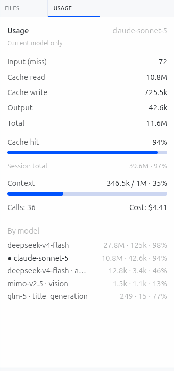

# Hermes Tally

[English](README.md) | [简体中文](README.zh.md)

给 [Hermes Agent](https://github.com/NousResearch/hermes-agent) 桌面应用做的一个右侧栏用量面板:实时 token 消耗、**正确计算**的缓存命中率、上下文占用、以及你当前实际在用的模型的预估成本。

 



*真实会话截图:这是一个先跑在 `deepseek-v4-flash` 上、中途切到 `claude-sonnet-5` 的会话。头部数字(94% 命中率、11.6M token)描述的是 Claude——当前实际在用的模型;下方 "Session total"(39.6M · 97%)保留了整个会话的生涯累计数字供参考;按模型明细则列出了这个会话涉及的所有模型/任务,包括 Hermes 自己在后台调用的辅助模型(`glm-5` 做的 `title_generation`、`mimo-v2.5` 做的 `vision`)。*

## 为什么做这个

Hermes 自带的状态栏只显示上下文窗口占用。它不显示缓存命中率、按模型拆分的成本,也没有一个可以在对话中随时瞥一眼的常驻读数——就是 Kilocode 侧边栏那种"一眼可见"的体验。Hermes Tally 补上了这块。

有两点不是纯装饰,值得说清楚:

- **缓存命中率的计算是正确的**:`cache_read / (cache_read + cache_write + input_miss)`。`cache_write`(Anthropic 的 `cache_creation_input_tokens`——刚写入缓存的新内容)本身就是一次**未命中**,不是命中。如果分母里漏掉它,在 DeepSeek 上看起来完全正常(它的 API 从不上报 `cache_write`),但换到 Claude 就会把每个会话的命中率悄悄推高到接近 100%——这是我们自己踩过的坑。
- **头部数字只统计你当前正在用的模型**,不是整个会话的生涯汇总。Hermes 的 `state.db` 里 `sessions` 表的那一行,是**整个会话生涯**用过的所有模型的累计——如果你在模型 A 上跑了 1000 万 token 然后切到模型 B,那一行数字描述的还是模型 A。Hermes Tally 会把 `session_model_usage` 表过滤到当前模型自己的主循环调用(排除 approval/vision/title-generation 这些辅助调用),并且明确标注数据范围,同时把整会话总量作为次要信息保留在下方,不丢失任何信息。

## 面板显示什么

- 输入(缓存未命中)、缓存读取、缓存写入、输出、总计——针对当前活跃模型,当前会话
- 缓存命中率,带进度条
- 上下文窗口占用(已用 / 上限,百分比)
- API 调用次数、预估成本
- 按模型/任务的明细(当前模型用 `●` 标记),包括 Hermes 在后台悄悄调用的辅助模型(标题生成、工具调用审批、视觉识别)
- 一个紧凑的状态栏 chip(`92% · 4.6M`),不用打开面板就能扫一眼

全程**只读**——读取 Hermes 自己本地的 `state.db`,从不写入,也从不接触 prompt 或回复的具体内容。

## 工作原理

两个小部件:

1. **一个桌面 UI 插件**(`desktop-plugins/usage-panel/`)——右侧栏面板 + 状态栏 chip,纯 ESM,无需构建,Hermes 桌面应用会热加载它。
2. **一个 Python 后端**(`plugins/usage-panel/dashboard/`)——一个很小的只读 FastAPI 路由,挂载进 Hermes 自己的网关进程里。这是唯一能拿到 `cache_read`/`cache_write`/按模型成本的地方(Hermes 的实时 RPC 不暴露这些字段——详见下方架构说明)。

面板通过会话的**持久 id**调用后端(通过 `session.active_list` 解析得到,因为桌面端的 `activeSessionId` 是运行时 id,和 `state.db` 里的行对不上——如果你要在此基础上二次开发,请看下面的说明)。

## 安装

需要已经装好 [Hermes Agent](https://github.com/NousResearch/hermes-agent) 桌面应用。

```bash
git clone https://github.com/<你的用户名>/hermes-tally.git
cd hermes-tally

# 1. 渲染层插件(自动热加载)
cp -r desktop-plugins/usage-panel ~/.hermes/desktop-plugins/

# 2. Python 后端
cp -r plugins/usage-panel ~/.hermes/plugins/
hermes plugins enable usage-panel --no-allow-tool-override
```

然后在桌面应用里:`Cmd+K` → **Reload desktop plugins**。右侧会立刻出现一个 **Usage** 面板。

**缓存/成本数字需要多一步**:Python 后端的路由只在 Hermes 桌面后端进程**启动时**挂载一次,所以安装后需要**完全退出并重新启动一次桌面应用**。在那之前面板照常可用,只是缓存读写和成本会显示 `—`。

如果你用的是命名 profile(`hermes -p <name>`),对应文件放到 `~/.hermes/profiles/<name>/...` 下即可。

### 多台电脑

这个仓库里的东西就是全部所需——在每台机器上重复那两条 `cp` 命令和 `hermes plugins enable usage-panel` 即可。没有配置项,没有密钥,没有需要同步的机器状态。

## 卸载

```bash
hermes plugins disable usage-panel
rm -rf ~/.hermes/desktop-plugins/usage-panel ~/.hermes/plugins/usage-panel
```

## 架构说明

给想在此基础上二次开发的人(或者想搞清楚为什么某个数字是 `0`/`—` 的人):

- Hermes 的网关 RPC(`session.usage`、`session.context_breakdown`)**不**暴露 `cache_read_tokens` / `cache_write_tokens` 或按模型成本——这些只存在于 `state.db`(`sessions` 和 `session_model_usage` 两张表)。这就是为什么这个插件需要一个 Python 后端,而不能只靠 RPC 调用。
- 桌面端的 `host.state.activeSessionId` 是一个**运行时 id**(例如 `5d6aa061`),不是 `state.db` 里作为主键的**持久 id**(例如 `20260811_114221_7caa06`)。插件通过 `session.active_list` 解析这个映射,它返回的每一行都带 `session_key`(即持久 id)。如果后端查询直接用运行时 id,会静默返回"找不到"。
- `sessions` 表的字段是这个会话**用过的所有模型/任务的生涯累计**,不是"当前模型的数字"。按 (模型, 任务) 拆分的数据在 `session_model_usage` 表里;本插件会把这张表过滤到当前活跃模型的非辅助调用行,作为头部数字。
- 缓存命中率公式:`cache_read / (cache_read + cache_write + input)`。千万不要把 `cache_write` 从分母里漏掉——原因见上面"为什么做这个"一节。

## 相关项目

还有几个 Hermes 用量/成本相关的插件,定位和设计取舍各不相同——如果这个不适合你的场景,可以看看:

- [ANDYPENG09/hermes-cache-hit-rate](https://github.com/ANDYPENG09/hermes-cache-hit-rate) —— 在 Web Dashboard 的 Analytics 页面显示缓存命中率(不是桌面侧栏)。
- [TurkeyGuoba/ai-usage-monitor](https://github.com/TurkeyGuoba/ai-usage-monitor) —— 更完整的独立监控工具,自带服务进程、多 provider 价格表、多币种显示,把 Hermes 桌面插件作为其中一个前端。
- [8bit64k/cronalytics](https://github.com/8bit64k/cronalytics) —— 专门针对 cron 定时任务的用量/成本归因。

Hermes Tally 是这几个里最"轻"的一个,刻意如此:没有独立服务进程,没有需要维护的价格表,直接读 Hermes 自己的 `state.db`,渲染进侧边栏就完事。

## 许可证

MIT
